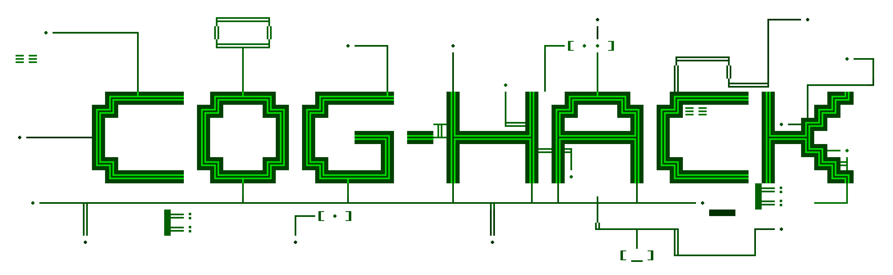

# cog-hack

<p align="center">
  
</p>

cog-hack is a mod layer for **Cogmind** (currently built against Beta 17.1), in the spirit of
DFHack. It replaces the game's `SDL.dll` with a proxy that loads the real one and adds:

- an overlay drawn in the game's own font (panels, labels on any UI cell)
- an AngelScript console and scripts that can read and change game state
- native plugins (DLLs) with a small C API
- live access to the game's UI: the window tree, screen text, the hovered element
- hotkeys for memory snapshots and text dumps, for reverse engineering

## Goals

cog-hack adds a layer on top of the game for new tools, quality of life tweaks, and eventually new
content. Cogmind is still actively updated, so this isn't about keeping a finished game alive. The
aim is to let players add things the game doesn't have: new enemies, weapons, utilities, and new
gameplay or UI elements.

It is not trying to:

- bulk reverse engineer or publish the game's content
- unlock hidden or unreleased content
- make cheating easy

The point is to add to the game while leaving the way you play it as it is.

## Safety

- Native plugins (DLLs) only load when listed in `hack\plugins.txt`, ideally pinned to their
  SHA-256 hash so a changed file is refused. A plugin runs inside the game with your user
  account's rights, so it has full access to your system. Only enable ones you trust.
- Scripts can only use the API: no files, network or processes. Writes to code or read-only
  memory, and setting your own stats directly (`set_core` and the like), need `dev_mode=1`.
  Scripts can't load files outside `hack\scripts\`.
- A watchdog stops scripts that run too long, so a bad loop can't freeze the game.
- The command that deletes your save (`CMD_GAME_DELETE_QUIT`) is refused.
- Snapshots are copies of game memory and may contain personal data (Steam session, paths, user
  name). Don't share them publicly. Keystrokes are never logged.

## Status and limitations

- Only Beta 17.1 (build 260906a) is mapped. Other builds are detected and run with limits (see
  "Game updates" below).
- Many game systems are not mapped yet. What is mapped: player state, items, robots, definitions,
  logs and the UI.
- New content can't be added yet. The game's content is designed to be hidden, and the best
  way to extend this is yet undecided. For now, existing item and robot definitions can be changed
  in memory.
- Windows only (the game is a 32-bit Windows program), built with a cross compiler.

## Build and install

Built from WSL or Linux with mingw-w64 (`i686-w64-mingw32-gcc`) and Python 3.

```sh
make deps      # once: download AngelScript 2.38.0 and check its sha256
make           # build/SDL.dll and build/plugins/*.dll
make test      # offline tests
make install   # close the game first
./uninstall.sh # put the original SDL.dll back
```

`make install` keeps the original as `SDL_orig.dll` (and a one-time `SDL.dll.pristine`). Steam's
"verify integrity of game files" also restores the original.

It installs to the default Steam folder
(`/mnt/c/Program Files (x86)/Steam/steamapps/common/Cogmind`). For a different folder, set
`COGMIND_DIR` (the plugin repos read it too):

```sh
make install COGMIND_DIR=/mnt/d/Games/Cogmind
COGMIND_DIR=/mnt/d/Games/Cogmind ./uninstall.sh
```

On Windows, build inside WSL or a container. Install a mingw-w64 cross compiler, make, Python 3, curl and unzip
(Debian/Ubuntu: `sudo apt install mingw-w64 make python3 curl unzip`). `make install` reaches the
game through `/mnt/c`.

## Using it

Everything the mod writes goes in `<game>\hack\`: `hook.log`, `config.txt`, `plugins.txt`,
`scripts\`, `plugins\` and `snapshots\`.

| key | what it does |
|---|---|
| Pause or Ctrl+F12 | show or hide the overlay |
| Ctrl+F9 | open the AngelScript console (type `.help`) |
| Ctrl+F10 | text dump of the player, items and robots |
| Ctrl+F11 | memory snapshot, plus the screen as text and as a .bmp |
| Ctrl+Shift+F11 | screen text and UI tree only (fast, never deleted) |
| Ctrl+Shift+F10 | start or stop a UI recording of the `ui_record` console (see below) |

### Enabling plugins

Plugins are DLLs in `hack\plugins\`, and none load until you enable them in `hack\plugins.txt`.
The game creates that file on its first launch with every line commented out. Put one DLL name per
line; `#` starts a comment:

```
ui_inspect.dll
example.dll   # sample plugin
```

To pin a plugin, add its SHA-256 after the name (`ui_inspect.dll 3d87d8f5...`, the full 64
characters): the DLL is then refused if the file ever changes. `hook.log` prints each DLL's
SHA-256 when the game starts. Plugins load once at startup, so restart the game after editing the
file.

If the game crashes, `hook.log` gets a short report: where it crashed, whether the mod's code
was running at the time, and the last commands and key presses. A minidump goes to
`hack\snapshots\crash_N.dmp`. The previous session's log is kept as `hook.prev.log`.

### Title screen and boot sequence

cog-hack leaves its mark on two of the game's screens:

- **Title screen:** once the Cogmind logo has finished drawing, it glitches and turns into the
  COG-HACK logo. Set `title_art=0` to turn this off.
- **New game:** the boot sequence gets one extra line after PREPARING CONTROL OVERLAY,
  `INJECTING COG-HACK`, typed like the game's own lines and ending in an `ACTIVE` box. The
  `intro_*` settings change the text, which line it follows, or turn it off.

The logo art is `art/coghack.txt`. [docs/art.md](docs/art.md) explains how both screens work and
how to edit the art.

Settings are in `hack\config.txt`, written with comments on first launch. You can change the
hotkeys there (for example `hotkey_console=ctrl+f9, f8`). When a new version adds settings, the file
is rewritten with your values kept.

## Scripts

`hack\scripts\autoexec.as` runs at startup. In the console, `.load file.as` loads another script.
Scripts can `#include` other files in `hack\scripts\`. Define `void onFrame()` or
`void onCommand(int id, const string &in name)` to react to events.

Scripts can read the player, items, robots and definitions, change them, send game commands and
keys, read the UI and draw labels on it. [docs/scripting.md](docs/scripting.md) lists every
function.

## Plugins

A plugin is a 32-bit DLL that exports `cogmind_plugin_init(const cm_host_api *api)`. Through the
API it can register script functions, read and write memory (guarded), run game commands, get a
callback every tick, draw panels and labels, and receive hover and click events. See
`include/plugin_api.h` and `plugins/example/`.

Helper headers for plugins (header-only, read-only):

- `cm_state.h`: the player, parts and inventory as plain structs, build math, message logs
- `cm_ui.h`: the UI tree, screen text, mouse and hover
- `cm_map.h`: the current floor (known tiles, items, machines)
- `cm_addr.h`: call `cm_addr_init(api)` so the plugin uses the addresses the host found

Plugins only load if they are listed in `hack\plugins.txt` (see "Enabling plugins").

## UI recordings

For reverse engineering animations: set `ui_record=CTitle` (any console class) and the hook writes
the cells of that console's children on every frame they change, from the moment it appears, to
`hack\snapshots\rec_N.bin`, plus the screen as `.bmp` every `ui_record_bmp` frames.
`tools/re/uirec.py rec_N.bin` prints what changed when, and `from uirec import frames` reads it.

## UI coordinates

The game's UI is a tree of consoles (`XRoot` > `CMission` > windows like `CHud`, `CParts`, `CLog`,
`CMap` > rows and buttons). Positions are root cells: the screen as a grid of UI font cells (214x45
at 3440x1440). The map uses a bigger tile font, but its bounds are still given in root cells.

## Game updates

The addresses in `include/cogmind.h` were mapped on build 260906a. At startup the hook checks
which build is running and finds every address again using byte signatures from
`sigs/cogmind.sigs`. `hook.log` reports one of:

| result | meaning | what runs |
|---|---|---|
| `known` | the build this was mapped on | everything |
| `compatible` | another build, nothing moved | everything |
| `ADAPTED` | some addresses moved, all were found again | reads, scripts, plugins (no writes or game calls) |
| `UNSUPPORTED` | an address could not be found | reads and scripts only |

`version_check=0` in config.txt turns these limits off. A `hack\sigs.txt` in the same format as
`sigs/cogmind.sigs` replaces the built-in signatures, so updated ones can be tried without a
rebuild. [docs/rederive.md](docs/rederive.md) explains how to find addresses again and regenerate
the signatures and data tables.

## Layout

```
src/hook/      the SDL proxy, hotkeys, synthetic input, UI events for plugins
src/base/      log, config, guarded memory access
src/game/      build check and signatures, player, definitions, logs, commands
src/overlay/   overlay drawing, fonts, panels and labels
src/script/    AngelScript engine, script API, plugin loader
src/debug/     snapshots and text dumps
include/       headers for plugins (plugin_api.h, cogmind.h, cm_*.h)
sigs/          byte signatures (built in, and the format for hack\sigs.txt)
plugins/       example plugins: example, ui_inspect
scripts/       scripts installed to hack\scripts
tests/         offline tests; replay.c runs the plugin headers against a snapshot
art/           the COG-HACK title art (text; tools/title_art.py builds it in)
tools/         build helpers; tools/re/ has the reverse engineering scripts (uirec.py reads UI recordings)
docs/          scripting.md (the script API), rederive.md, art.md (REXPaint conventions, the title and boot animations)
```

## Credits

- [Cogmind](https://www.gridsagegames.com/cogmind/) is made by Josh Ge (Grid Sage Games). cog-hack
  is an unofficial mod and needs your own copy of the game.
- [AngelScript](https://www.angelcode.com/angelscript/) by Andreas Jönsson (zlib license),
  downloaded by `make deps`.
- [Cog-Minder](https://github.com/noemica/cog-minder) data was used to check item and robot fields.
- [DFHack](https://github.com/DFHack/dfhack) for the idea, and
  [UE4SS](https://github.com/UE4SS-RE/RE-UE4SS) / [patternsleuth](https://github.com/trumank/patternsleuth)
  for the signature approach.

## License

cog-hack is under the [Mozilla Public License 2.0](LICENSE), except the parts meant to be built
into or copied by your own work, which are under the [MIT license](LICENSE-MIT):

- `include/`: the plugin API and the helper headers (they are compiled into every plugin)
- `plugins/`: the example plugins
- `scripts/`: the bundled scripts

So a plugin or script can use any license. Each source file names its license on its first lines
(`SPDX-License-Identifier`). Under MPL-2.0, if you distribute a changed version of one of the other
files, that file stays under MPL-2.0 and its source must be available.

The licenses cover cog-hack's own code and art, not Cogmind, its data, its name or its logo.

A built `SDL.dll` also contains AngelScript (zlib license) and the MinGW-w64 runtime (including
winpthreads, MIT-style). Ship their license notices with any binary release.
